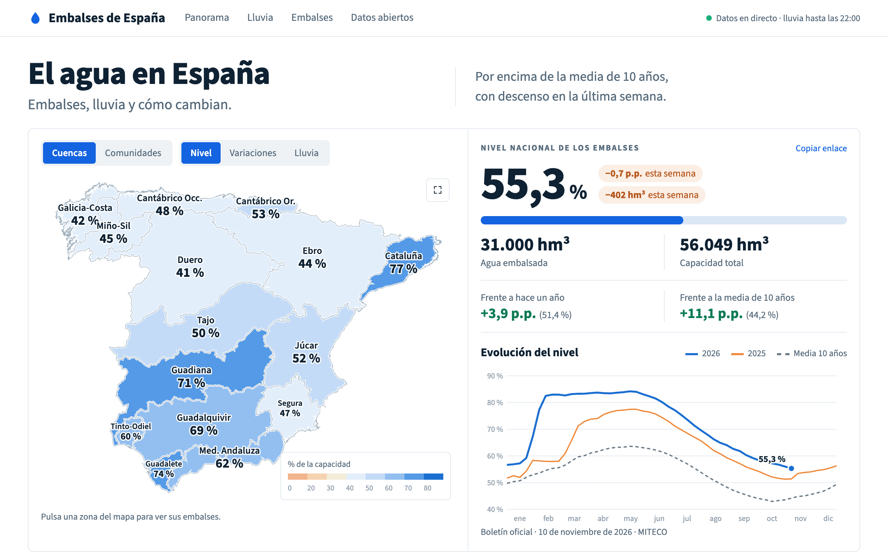

# embalses

[](https://lakehousebox.com/a/II58fpqq/embalses-el-agua-en-espana)

**Where is it raining in Spain, and is that rain reaching the reservoirs?**

A live, open dataset joining Spain's official rain gauges, river gauges and reservoirs, kept up to date inside [LakehouseBox](https://lakehousebox.com). It is published as a public Apache Iceberg catalog and read straight from the browser.

- **The page:** <https://lakehousebox.com/a/II58fpqq/embalses-el-agua-en-espana>. A LakehouseBox artifact ([`artifact/page/index.html`](artifact/page/index.html)): LakehouseBox attaches the public catalog and the page's SQL runs in DuckDB 2.0 in the visitor's browser. The map outlines come from the catalog too, so the page holds no data and has no backend. It has deep links to every basin, region, province and reservoir, a live SQL box and CSV download. The old address, <https://lakehousebox.github.io/embalses/>, redirects there.
- **Data:** the public catalog `embalses`. Attach it from any DuckDB, no account needed:

  ```sql
  INSTALL iceberg; LOAD iceberg; INSTALL httpfs; LOAD httpfs;
  ATTACH 'jatorre/embalses' AS embalses (TYPE iceberg, ENDPOINT 'https://public-catalog.lakehousebox.com', AUTHORIZATION_TYPE 'none');
  SELECT * FROM embalses."now".reservoir_status LIMIT 10;
  ```

- **For AI agents:** [`docs/AGENTS.md`](docs/AGENTS.md) explains every table, how they join, the units and the caveats. LakehouseBox serves it at the catalog root.

## What's in it

| Namespace | What | Tables |
|---|---|---|
| `ref` | places | `basins`, `catchments`, `rivers`, `reservoirs`, `reservoir_catchments`, `stations`, `grid_cells`, `catchment_cells`, `map_outlines` (GeoJSON text for drawing) |
| `obs` | measurements, append-only | `precipitation`, `weather`, `reservoir_readings`, `river_flow`, `reservoir_weekly` (since 1988), `daily_weather` (since Oct 2023) |
| `now` | rebuilt hourly | `rain_grid` (H3), `upstream_rain`, `reservoir_status`, `basin_summary`, `station_status` |

Every column is documented in the catalog itself ([`docs/table_docs.json`](docs/table_docs.json)).

## How it works

```
official sources ──► scheduled SQL in LakehouseBox ──► Iceberg tables (obs.*)
                                                            │
                     scheduled SQL, sql/now/ (hourly) ◄──────┘──► now.* ──► the page (a LakehouseBox artifact)
```

- **Ingestion is SQL.** Each source is one query in [`sql/ingest/`](sql/ingest) that LakehouseBox runs on a schedule. It fetches the publisher's own feed, reshapes it and appends it to an Iceberg table.
- **Derived tables are SQL too.** One query per table in [`sql/now/`](sql/now), run hourly by LakehouseBox itself:
  - rain is interpolated onto an H3 grid (inverse distance, gauges within 40 km);
  - it's averaged over every catchment upstream of each dam;
  - and compared with live storage and the same week in past years.
- **The page is one file.** [`artifact/page/index.html`](artifact/page/index.html), plain HTML and JavaScript with no build step, plus its font in `artifact/assets/`. It reads the catalog through LakehouseBox's artifact runtime (`lhbox.query`), so it runs inside LakehouseBox rather than from a local server.

There is no server, worker or cron job of ours anywhere: LakehouseBox runs the SQL and serves the page.

## Everything is code

Nothing was set up by hand in a console. The whole deployment is in this repository, and CI keeps LakehouseBox equal to `main`.

| What | Where | Applied by |
|---|---|---|
| Tables, partitioning, column comments | [`sql/migrations/`](sql/migrations): plain DuckDB DDL, numbered, append-only | `lhbox migrate` |
| Catalog, connection, POST prefixes, the 14 scheduled sinks | [`lakehouse.yaml`](lakehouse.yaml), or the same in [`main.tf`](main.tf) | `lhbox apply`, or `tofu apply` |
| The SQL each sink runs | [`sql/ingest/`](sql/ingest), [`sql/now/`](sql/now) | with its sink |
| Documentation served by the catalog | [`docs/AGENTS.md`](docs/AGENTS.md), [`docs/table_docs.json`](docs/table_docs.json) | with the catalog |
| The page | [`artifact/`](artifact) | `lhbox artifact publish` (CI, on every change) |
| Redirect from the old address | [`site/`](site) | GitHub Pages |

Tables are migrations rather than Terraform resources on purpose: a schema is changed by a reviewed, ordered script, and no `apply` can ever drop a table or its rows. It is the usual split between Flyway or dbt for schemas and Terraform for infrastructure.

**CI** ([`.github/workflows/lakehouse.yml`](.github/workflows/lakehouse.yml)):

- a pull request shows what would change: `lhbox migrate --dry-run`, `lhbox plan` and `tofu plan`;
- a merge to `main` runs `lhbox migrate` and `lhbox apply`;
- then OpenTofu adopts the live catalog and plans [`main.tf`](main.tf) against it. That plan must be empty, so the two declarations cannot drift apart.

The only secret is one LakehouseBox API key. The AEMET key is an integration held by LakehouseBox and never appears in the repository, in CI or in Terraform state.

**Loaded once, not on every merge:** the reference geography in [`sql/reference/`](sql/reference) (basins, catchments, rivers, stations, map outlines) and the history backfills in [`tools/`](tools) (MITECO weekly bulletin since 1988, AEMET daily values since 2023). They are scripts you run when the source changes.

## Sources

Official sources only, credited as their publishers ask:

- **MITECO**: weekly reservoir bulletin (*Boletín Hidrológico*), dam inventory (*Inventario de Presas y Embalses*), SAIH station register, river basin districts.
- **AEMET OpenData**: hourly and daily weather observations.
- **SAIH real-time networks** of the river-basin authorities: Ebro, Guadalquivir, Guadiana, Segura, Miño-Sil and Cantábrico (more to come).
- **HydroSHEDS** ([Lehner & Grill 2013](https://www.hydrosheds.org)): HydroBASINS and HydroRIVERS, CC BY 4.0.

Real-time values are provisional: the publishers haven't validated them.

## Run it yourself

```sh
lhbox catalog create embalses
lhbox migrate --catalog embalses      # creates the 20 tables from sql/migrations/, with partitioning and descriptions
lhbox plan -f lakehouse.yaml          # shows what apply would create or change
lhbox apply -f lakehouse.yaml         # connections, POST prefixes, the 14 scheduled sinks, table descriptions
```

### With OpenTofu or Terraform

[`main.tf`](main.tf) declares the same deployment for the [LakehouseBox provider](https://registry.terraform.io/providers/LakehouseBox/lakehousebox), which installs with both `tofu` and `terraform`:

```sh
export LHBOX_API_KEY=...     # `lhbox login` makes one
tofu init
tofu apply -target=lakehousebox_catalog.embalses    # the catalog first
lhbox migrate --catalog embalses                     # then its tables
tofu apply                                           # then everything that fills and documents them
```

To adopt a catalog that already exists, [`tools/tofu_adopt.sh`](tools/tofu_adopt.sh) imports its 40 resources and shows the plan. It is what CI runs.

## Licence

The code is under the [Apache License 2.0](LICENSE). The artifact ships the Source Sans 3 font (Adobe, [SIL Open Font License 1.1](https://openfontlicense.org)). The data belongs to its publishers and keeps their terms: see [Sources](#sources).
